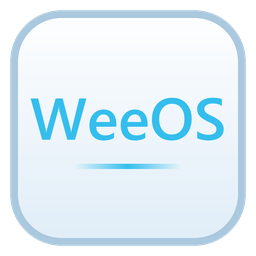
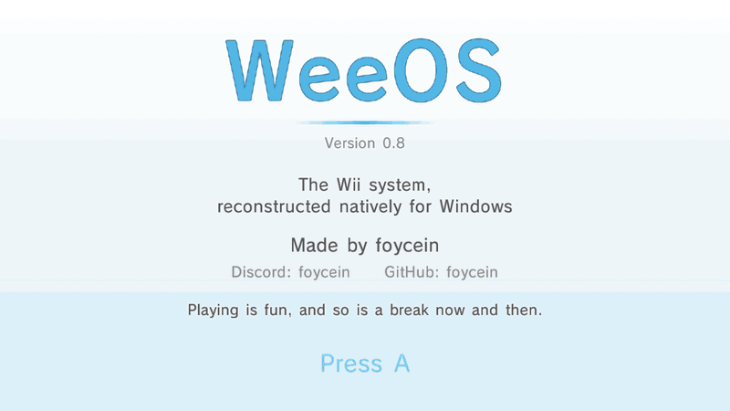
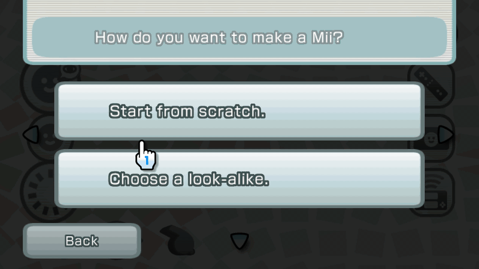
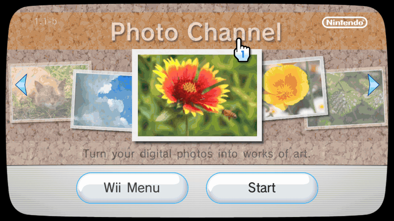
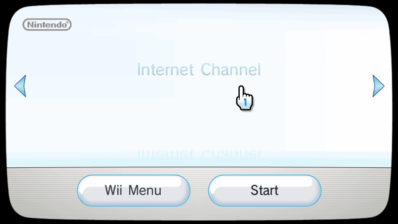
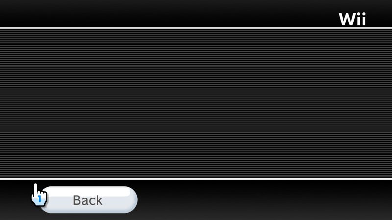
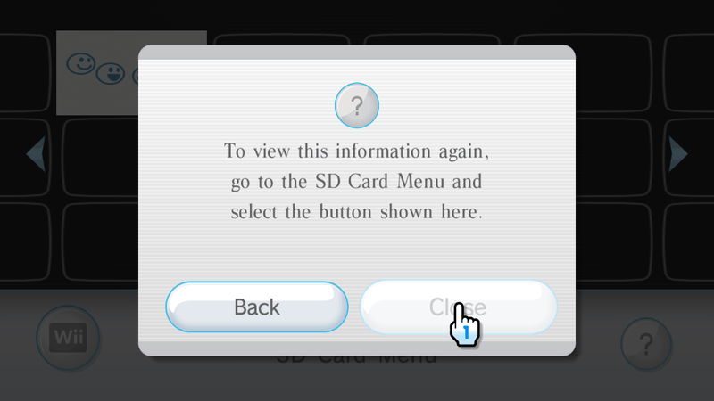
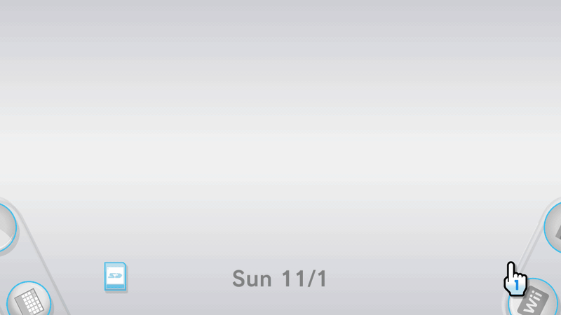
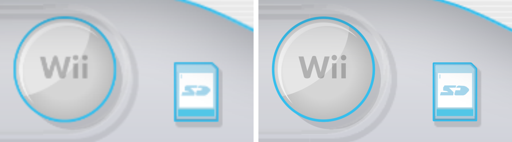

<div align="center">



# WeeOS

### The Wii System Menu, reconstructed natively for Windows. No emulation.

[](https://github.com/foycein/weeos/releases)
[](https://github.com/foycein/weeos/releases)
[](LICENSE)
[](https://github.com/foycein/weeos/discussions)



**[Download](https://github.com/foycein/weeos/releases/latest)** · **[Roadmap](#roadmap)** · **[Contribute](#contribute)**

</div>

<br>

## What it is

- **The real Wii system, as a Windows program.** Boot chain, IOS, the System Menu and the system channels, reconstructed natively in C++. Nothing is emulated: no Wii code runs, no hardware is simulated.
- **Your Wii, on your PC.** WeeOS imports your own console's NAND backup: your Miis, your saves, your channels, your settings.
- **Made for today's screens.** 16:9 everywhere, ultrawide without stretching, sharp redrawn art at 4K, mouse and keyboard or real Wii Remotes.

<br>

## Gallery

<table>
<tr>
<td width="50%"><br><sub><b>HOME Menu</b>: remote settings, volume, rumble</sub></td>
<td width="50%"><br><sub><b>Mii Channel</b>: make a Mii from scratch</sub></td>
</tr>
<tr>
<td><br><sub><b>Photo Channel</b>: your SD card's photos</sub></td>
<td><br><sub><b>Internet Channel</b>: start page and favorites</sub></td>
</tr>
<tr>
<td><br><sub><b>Wii Settings</b>: with PC Settings for the window, sound and controls</sub></td>
<td><br><sub><b>Data Management</b>: copy saves to the SD card and back</sub></td>
</tr>
<tr>
<td><br><sub><b>SD Card Menu</b>: channels on the SD card</sub></td>
<td><br><sub><b>Message Board</b>: memos, calendar and play log</sub></td>
</tr>
</table>

<div align="center">

<sub>Left: the Wii's own resolution, scaled to 4K. Right: WeeOS draws the menu sharp at 4K.</sub>
</div>

<br>

## Get started

1. **Make a backup of your own Wii** with [BootMii](https://wii.hacks.guide/bootmii): you get `nand.bin` and `keys.bin`.
2. **[Download WeeOS](https://github.com/foycein/weeos/releases/latest)**: the installer `weeossetup.exe` or the portable zip.
3. **Start it** and choose your `nand.bin`. Your Wii is imported and starts up.

| Wii Remote | PC |
|---|---|
| **Pointer** | Mouse |
| **A / B** | Left / right mouse button (B also Esc) |
| **+ / −** | Mouse wheel or the + and − keys |
| **HOME** | Home |
| **D-pad, 1, 2** | Arrow keys, 1, 2 |
| **Fullscreen** | F11 or Alt+Enter |

Real controllers work too: Wii Remotes (Bluetooth or a Dolphin Bar) with Nunchuk or Classic Controller Pro, Joy-Cons and Xbox controllers.

WeeOS includes no Nintendo files. It runs only with a backup of a Wii you own.

<br>

## Roadmap

The goal: **the whole Wii as a native PC system.** Every menu, every channel, every sound, and in the end your games, running on WeeOS the way they run on the console.

### ✅ 1. The console wakes up
- The boot chain from boot2 to the System Menu, with the console's own keys and certificates
- IOS rebuilt as native services: file system, title management, ES, the SD card, USB, network, Bluetooth remotes, power and the front panel
- All 29 IOS versions of a real console, each with its own behavior
- NAND import from a BootMii backup, with every Mii, save and channel

### ✅ 2. The System Menu
- Welcome screen, Wii Menu with its pages, the zoom into a channel and the start window
- The HOME Menu with remote settings, battery, volume and rumble
- Wii Options, Wii Settings and the PC Settings pages
- Data Management and the SD Card Menu, with copy, move, erase and drag and drop
- The Message Board with its calendar, memos, photos and play log
- The soft keyboard, every dialog, the menu sounds and music with the console's own reverb

### ✅ 3. The channels
- **Mii Channel**: the editor, the plaza, the parade with footsteps
- **Photo Channel**: photos and movies from the SD card, slide shows, posting to the board
- **Internet Channel**: a modern Chromium engine inside the Wii's own interface, favorites included
- **Wii Speak Channel**: with your PC's microphone
- **Forecast, News and Wii Shop**: they start, Forecast and News with their manuals, ready for the online services
- **Disc Channel**: its place on the Wii Menu and its start window, waiting for a disc

### ✅ 4. Made for PC
- 16:9 everywhere, ultrawide and 16:10 without stretching, borderless fullscreen
- Sharp redrawn pictures for 4K: the menu, the HOME Menu, buttons, icons and banners
- Mouse and keyboard, or real controllers: Wii Remotes, Dolphin Bar, Nunchuk, Classic Controller Pro, Joy-Cons, Xbox
- One portable folder or an installer; the SD card is a folder you can open

### 🔜 5. Online again
- A self-hostable server that brings the online channels back: Forecast, News, Wii Shop, Message Board mail between WeeOS consoles
- WeeOS connects through the PC, with nothing to configure

### 🔜 6. Sharper still
- An optional modern typeface in the Wii's style
- The last pictures redrawn for 4K

### 🔜 7. Discs
- The Disc Channel loads your own disc images (ISO, WBFS, RVZ and more), and ejects them, like the slot on the console

### 🔜 8. Native game ports
The breakthrough this project is built for: Wii games running on WeeOS as native Windows programs.
- A game's code is converted **once, ahead of time**, into a native x64 program, the way recompilation projects brought other consoles' games to PC
- While it runs, nothing is emulated: the game calls WeeOS's real IOS, file system, controllers and sound
- Its graphics and audio go straight to Vulkan and Windows
- The first targets: Wii homebrew, then a first full game

### 🔜 9. Load and play
- Choose a disc image in the Disc Channel, WeeOS converts it on its first start, and from then on it simply starts like on the console
- Lighter, faster conversion, until loading a game feels instant

<br>

## Build from source

Windows 10/11 x64 · Visual Studio 2022 · CMake 3.20+ · Ninja · [Vulkan SDK](https://vulkan.lunarg.com/)

In a Developer Command Prompt for VS 2022:

```
git clone https://github.com/foycein/weeos
cd weeos
cmake -S . -B build -G Ninja -DCMAKE_BUILD_TYPE=Release
cmake --build build
build\source\WeeOS\WeeOS.exe
```

<br>

## Contribute

WeeOS is big, and it gets finished together. Systems programmers, reverse engineers, artists, testers with real Wiis: all welcome.

- Read **[AGENTS.md](AGENTS.md)** first. It holds the rules for everyone, people and AI tools alike. Rule number one: extremely readable code.
- Pick an [issue](https://github.com/foycein/weeos/issues) or start a thread in [Discussions](https://github.com/foycein/weeos/discussions).
- Have real Wii Remotes, Joy-Cons or a Dolphin Bar? Testing them is one of the most valuable things you can do right now.

<br>

## Credits

Made by **foycein**: [GitHub](https://github.com/foycein) · Discord: `foycein`

Thanks to the Wii homebrew and preservation community, whose public documentation made understanding the console possible.

<br>

## Legal

WeeOS is an independent project. It is **not affiliated with, endorsed, sponsored or approved by Nintendo** or any other company. Wii, Mii, Wii Remote, Nunchuk and related names are trademarks of Nintendo; they are used here only to describe what WeeOS is compatible with.

- **No Nintendo files are included.** WeeOS contains no Nintendo software, firmware, keys, fonts, sounds, pictures or other copyrighted material. It needs a backup of a Wii console that you own, made by you.
- **Clean reconstruction.** WeeOS is original code written to be compatible with the Wii's system, for interoperability, preservation and research. It contains no code copied or mechanically derived from Nintendo's software.
- **Your responsibility.** You are responsible for following the laws of your country and the terms that apply to your console and software. Use backups only of consoles and software you legally own. Do not use WeeOS for piracy; requests for or links to pirated content are not welcome in this project.
- **No warranty.** WeeOS is provided "as is", without warranty of any kind, express or implied. The authors and contributors are not liable for any claim, damage, loss of data or other liability arising from its use. See [LICENSE](LICENSE).
- **Rights holders.** If you believe something in this repository infringes your rights, please open an issue or contact the maintainer, and it will be reviewed and handled promptly.
